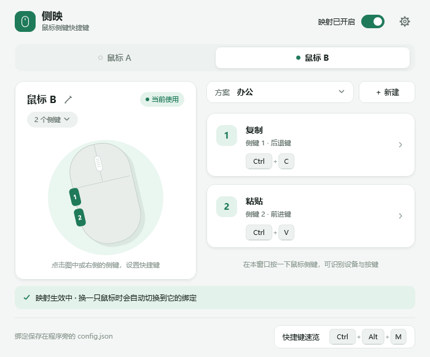
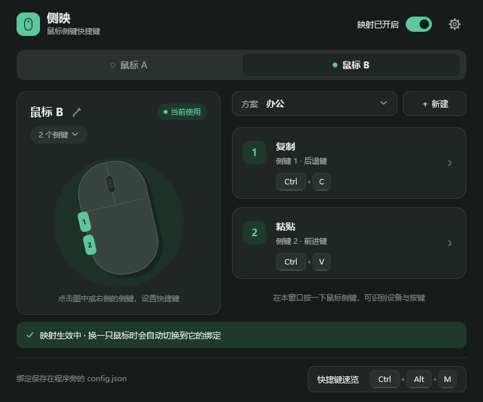

# 0.3.0 外部改动合入评估

日期：2026-10-22。比较基线：0.2.0（`6e32927`）。外部方案来自本地 `side-mapping-0.3.0-changed-files`，该目录是修改文件集合，未将其中缺少的文件视为删除。

## 评估结论

整体采用新 UI。它延续 Win32 / Direct2D / DirectWrite，实现成本和运行依赖适合轻量工具；设备选择、方案选择、侧键编辑和速览入口的层次也更清楚。保留独立鼠标档案、手动方案和第 2 版配置格式。

| 外部改动 | 处理与理由 |
| --- | --- |
| 分层配色、圆角卡片、轻阴影、设备分段选择 | 采用，主操作集中且保留原窗口尺寸 |
| 可点击鼠标插画、动作名称、键帽、状态色 | 采用，能更快看懂物理侧键对应哪个快捷键 |
| 编辑 / 设置 / 名称对话框、8 个预设 | 采用，中文操作更统一；操作名是通用提示，实际效果由目标应用决定 |
| 浅色 / 深色主题、标题栏与原生 EDIT 配色 | 采用；系统版本不支持的标题栏属性由 Windows 忽略 |
| 自动速览不注册 Esc | 采用，避免前台程序收不到 Esc；手动打开仍可用 Esc 关闭 |
| 设置焦点复位、录制不可用提示、菜单定位及 `&` 转义 | 采用，修复交互问题且不改变既有映射策略 |
| 仅单侧键鼠标学习物理按钮位置 | 采用，双侧键交替输入不应改写配置；抽为模型函数并验证所有方案的绑定迁移 |
| 清除多鼠标冲突后的旧选择 | 采用，多个候选设备仍存在时刷新不会恢复未经确认的旧设备 |
| 保存错误提示、开关回滚、启动项检查当前路径 | 采用，界面状态应反映实际结果 |
| Unicode 截断、孤立代理字符替换 | 采用，避免设备名称被写为空字符串；补配置往返测试 |
| 速览按显示器 DPI 布局、热插拔有条件关闭编辑 | 采用；混合 DPI 多屏与实际拔插效果仍须实物确认 |
| 键盘输入同时填写扫描码 | 采用，继续使用原有虚拟键与扩展键标志；不声称已经验证特定游戏或远程桌面的兼容性 |

## 合入时补充调整

1. 绑定保存失败时回滚内存值，保留草稿和错误提示。否则后续保存其他设置，可能把上次失败的绑定一起写入。
2. 鼠标识别过程保存失败时，不再用“已识别”提示覆盖保存错误。
3. 设置页不再提前引用当前鼠标档案，允许尚无设备时打开；补无设备绘图检查。
4. 速览快捷键被占用时，底部提示使用实际可用的关闭和打开方式。
5. 多设备下拉入口为设备数量预留独立宽度，防止长名称覆盖数量；名称输入字体在退出时释放。
6. 设置项说明与实际行为一致：接入提示开关控制自动接入提示；托盘主动切换方案仍显示速览。
7. 程序资源、清单、使用说明统一为 0.3.0。外部提供的修改目录保留在本地并加入忽略规则，避免将重复源码混入仓库。

## 验证与边界

在本机 Windows x64 使用项目原有 llvm-mingw 工具链构建；执行核心测试、原生集成自检，以及通过实际绘图代码导出两种主题的主窗口、编辑、录制、设置、速览、单侧键、长名称、多设备和空设备页面。详细结果见 [验证记录](验证记录.md)。

没有修改用户真实配置或开机启动项；集成自检保持映射关闭并使用独立目录。未代替用户物理按下侧键，没有把混合 DPI 多屏、真实 USB 拔插及特定应用接收快捷键列为已经实测通过。
